README.md [101L]
README.md [164L]
# Software Factory All-in-One
<p align="center">
  
... [lean-ctx: omitted 5 lines]
Open-source **software factory**: one **planning repository** that holds requirements, derived documents, AI agent rules, CI, and a **prototype** — before real implementation repos exist.
... [lean-ctx: omitted 1 lines]
**One principle:** the user provides root `my-project-requirements.md`. The AI Agent detects that file and runs this factory. No manual template picking.
This folder is **100% generic** and must **stay** generic forever. Keep product names, people, org paths, tracker keys, and day-page URLs out of method docs and out of `templates/` — those belong in each product’s own `docs/OWNER_STANDING.md` after copy. Placeholder **examples** in the table below are sample fill-ins only; replace them for each product. Never reverse this rule when adding CI/CD, day-loop, or other practices.

**Enforced:** every push/PR runs `node scripts/check-forever-generic.mjs` (denylist in `scripts/forever-generic-denylist.json`). A planning sync that fails the same check is refused. Non-generic content cannot land on `main`.
## Contributing
Improvements that raise professionalism are welcome. See [`CONTRIBUTING.md`](CONTRIBUTING.md). Keep the kit **forever generic** — practices only, never one product’s private details.
## Why this factory exists
**Purpose:** one living place that holds the craft needed to build **any** software (and AI/software-backed products) so AI agents work at **maximum speed with maximum quality**. Agents bring speed; this factory brings the rails, judgment, stacks, day loops, and lessons that make quality repeatable — for hands-off agent coding **and** for professional revenue products. Grow it over time (languages, packs, lessons). Full north star: [`EXCELLENCE.md`](EXCELLENCE.md) § Why this playbook exists.
## Numbered layout
Method files are **prefixed so they sort in delivery order**. Keep this numbering when you add a new method doc.
```text
software-factory-all-in-one/
  README.md                 Entry (this file)
  LICENSE                   MIT
  00-USAGE.md               How a new user starts (requirements-driven)
  01-STEPS.md               Ordered steps idea → complete plan
  02-DELIVERY.md            Actor-loop delivery (no MVP mode)
  03-PROTOTYPE.md           Prototype / API-explorer guide
  04-FEATURE_SDLC.md        Feature depth for implementation repos
  05-PROMPTS.md             Ready agent prompts + audits
  06-LESSONS.md             Planning-process lessons
  07-judgment/              Judgment-only absorb of outside methods
  08-IMPLEMENTATION-DAY.md  Owner↔agent day pipeline
  09-CI-CD.md               CI/CD progressive phases for day closeout
  EXCELLENCE.md             North star + ratchet for every future upgrade
  coverage/                 Inventory + ✅/% of craft homes, software surfaces, **and** AI agent harnesses
  agents/                   Per-harness packs (Cursor, Codex, Claude, Gemini, Trae, …)
  technologies/             Per-stack packs (PHP, Laravel, Next.js, …)
  examples/                 Copyable samples (e.g. my-project-requirements)
  scripts/                  Factory self-checks (activation wiring)
  templates/                Skeleton of a new planning repository
```
... [lean-ctx: omitted 1 lines]
## When to Use It
Use it at the very start of a new product (an ERP, a booking app, a backend-only service, anything), before any implementation repository exists. It answers "what do I set up, in what order, and what does done look like?" so nothing is forgotten.
## What Is Inside
| File | Purpose |
... [lean-ctx: omitted 1 lines]
| [`03-PROTOTYPE.md`](03-PROTOTYPE.md) | How to build the prototype: a clickable UI in the exact production frontend stack, or an API explorer with mock responses for a backend-only product. |
| [`04-FEATURE_SDLC.md`](04-FEATURE_SDLC.md) | Adaptive feature-level delivery for the **implementation** repositories: decompose the SRS once, match engineering depth to risk, require evidence for completion. |
... [lean-ctx: omitted 1 lines]
| [`08-IMPLEMENTATION-DAY.md`](08-IMPLEMENTATION-DAY.md) | Fixed day pipeline for FE/BE implementation chats: day run-through → closeout (PR → **CI green** → CodeRabbit → merge → verify → **CD when configured**) → Pareto 20% + new-chat handoff. |
... [lean-ctx: omitted 1 lines]
| [`07-judgment/studio-company.md`](07-judgment/studio-company.md) + [`templates/docs/STUDIO_ORG.md`](templates/docs/STUDIO_ORG.md) | Studio-as-company seats, goals, atomic checkout (Paperclip patterns as judgment). |
... [lean-ctx: omitted 3 lines]
| [`07-judgment/integration-engineering.md`](07-judgment/integration-engineering.md) | Any external integration: interfaces, contract, adapter, idempotency, fallback. |
... [lean-ctx: omitted 4 lines]
| [`technologies/`](technologies/README.md) | Per-technology packs (official-docs distillations): best practices, use/stop lists, common mistakes. Start with `php/php-8.6`. |
... [lean-ctx: omitted 1 lines]
| [`templates/`](templates/) | Fill-in skeleton files laid out exactly like a new planning repository (includes `implementation/github-actions/` for FE/BE). |
... [lean-ctx: omitted 1 lines]
## Start a New Product
**Preferred path (requirements-driven):** follow [`00-USAGE.md`](00-USAGE.md) — seed the repo from this playbook, add root `my-project-requirements.md`, open the AI agent. The agent detects the file and runs planning.
... [lean-ctx: omitted 1 lines]
1. Create an empty **private** repository for the product's planning (for example `erp-planning`). Clone or copy from the public [Software Factory All-in-One](https://github.com/Galhoom22/software-factory-all-in-one) and start from its `templates/`.
2. Copy everything inside [`templates/`](templates/) to the new repository's root, including the hidden `.github/`, `.editorconfig`, `.gitattributes`, and `.gitignore`.
... [lean-ctx: omitted 1 lines]
   - `docs/` (including `AGENT_START.md`, `OWNER_STANDING.md`, `DELIVERY.md`, SEO, Docker, FE/BE guides, `REFERENCES.md`, `SCOPE_REJECTIONS.md`, `JUDGMENT.md`, `actors/`, `decision-logs/`, `learning-from-mistakes/`) → `docs/`
... [lean-ctx: omitted 1 lines]
   - `agent-discovery/` root pointers (`CLAUDE.md`, `GEMINI.md`, `llms.txt`, `.gemini/`, `.github/…`, `.windsurf/…`) → matching paths at the new repo root
... [lean-ctx: omitted 3 lines]
### Placeholders
| Placeholder | Example |
... [lean-ctx: omitted 1 lines]
| `{{ONE_LINE}}` | A bilingual planning workspace for product teams |
| `{{FRONTEND}}` | Next.js 16 + Tailwind CSS 4.3 |
... [lean-ctx: omitted 1 lines]
| `{{DATABASE}}` | PostgreSQL 18 + pgvector |
... [lean-ctx: omitted 3 lines]
| `{{NODE_LTS}}` | 26 (Active LTS at planning time — re-verify on nodejs.org) |
... [lean-ctx: omitted 1 lines]
| `{{COMPONENT_LIBRARY}}`, `{{ICON_LIBRARY}}`, `{{FONTS}}` | shadcn/ui (Radix base, RTL mode); Phosphor; Geist for Latin and IBM Plex Sans Arabic |
... [lean-ctx: omitted 1 lines]
## Keeping It Current
**Hard gate (Always-Current):** [`07-judgment/playbook-freshness.md`](07-judgment/playbook-freshness.md) — after every playbook change, finish the closeout checklist and run `node software-factory-all-in-one/scripts/check-playbook-freshness.mjs` before Done. Stale packs/%/pins are a professionalism failure.
... [lean-ctx: omitted 1 lines]
This playbook is a living document. Whenever work in a planning repository creates a practice worth repeating (a new document, a CI check, a test, a rule, a lesson learned), update the matching playbook file in the same commit. `AGENTS.md` makes this mandatory for AI agents. Keep it generic: write the practice, not the product details.
... [lean-ctx: omitted 1 lines]
### Before adding a practice
1. Read [`EXCELLENCE.md`](EXCELLENCE.md) ratchet (dimension up, none down).
2. Consult [`coverage/`](coverage/README.md). If the capability is already ✅ at high %, deepen that home instead of inventing a parallel file.
... [lean-ctx: omitted 1 lines]

