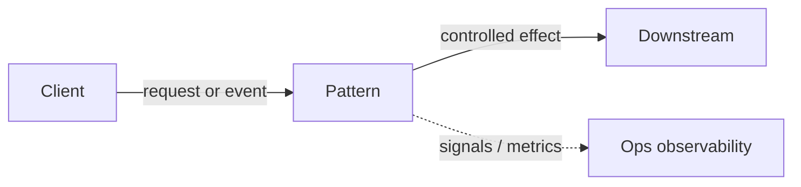

# Ambassador — problem and solution

## Problem and forces

Every service duplicates retries, TLS, logging, and auth headers when calling peers.

Forces typically include reliability under partial failure, operable complexity, cost of idle capacity, and security boundaries for untrusted clients or partners.

## Naive approach and why it fails

- Copy HTTP client boilerplate into each service; drift and missed security headers.

## Solution

An ambassador process or library owns outbound calls; the consumer talks locally to the helper.

## Analogy (original)

A press secretary takes questions for a speaker so the speaker never dials reporters one by one.

## Structure

| Participant | Role |
|-------------|------|
| Client / producer | Initiates work or reads |
| Pattern components | See Mermaid — names vary by pattern |
| Downstream dependency | Service, store, bus, or legacy system |

