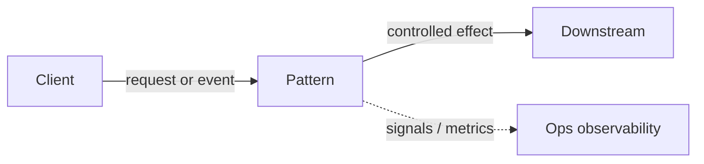

# Anti-Corruption Layer — problem and solution

## Problem and forces

New domains import legacy DTOs and names, freezing the new design to the old system.

Forces typically include reliability under partial failure, operable complexity, cost of idle capacity, and security boundaries for untrusted clients or partners.

## Naive approach and why it fails

- Call legacy APIs directly from new use-cases; rename fields ad hoc.

## Solution

A thin translation boundary maps legacy ↔ modern contracts; only the ACL knows both.

## Analogy (original)

A customs form converts units and labels so warehouse inventory never stores foreign SKUs.

## Structure

| Participant | Role |
|-------------|------|
| Client / producer | Initiates work or reads |
| Pattern components | See Mermaid — names vary by pattern |
| Downstream dependency | Service, store, bus, or legacy system |

