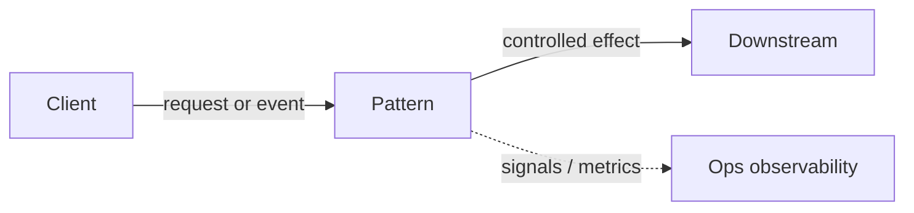

# Asynchronous Request-Reply — problem and solution

## Problem and forces

Long backend work blocks HTTP until timeout; clients retry and duplicate work.

Forces typically include reliability under partial failure, operable complexity, cost of idle capacity, and security boundaries for untrusted clients or partners.

## Naive approach and why it fails

- Keep the request open for minutes; increase timeouts everywhere.

## Solution

Return 202 + correlation id (or poll/webhook URL); process on a queue; publish completion.

## Analogy (original)

A dry-cleaner ticket: you leave clothes, get a claim number, return later for the finished item.

## Structure

| Participant | Role |
|-------------|------|
| Client / producer | Initiates work or reads |
| Pattern components | See Mermaid — names vary by pattern |
| Downstream dependency | Service, store, bus, or legacy system |

