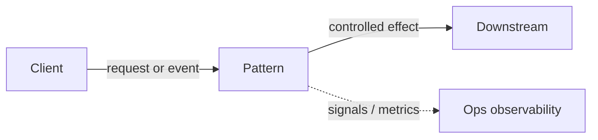

# Backends for Frontends — problem and solution

## Problem and forces

One public API serves every client and accumulates mobile-only and web-only fields and auth modes.

Forces typically include reliability under partial failure, operable complexity, cost of idle capacity, and security boundaries for untrusted clients or partners.

## Naive approach and why it fails

- Giant “god API” with feature flags per client type.

## Solution

Separate BFF services (or modules) tailored to each UI; they call shared domain services.

## Analogy (original)

Airport check-in desks for economy vs lounge: same airline, different counters and forms.

## Structure

| Participant | Role |
|-------------|------|
| Client / producer | Initiates work or reads |
| Pattern components | See Mermaid — names vary by pattern |
| Downstream dependency | Service, store, bus, or legacy system |

