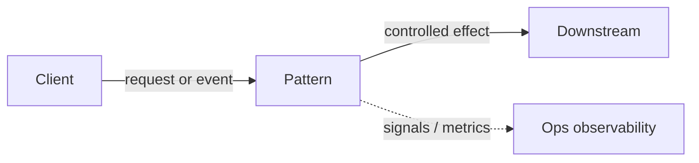

# Bulkhead — problem and solution

## Problem and forces

One noisy dependency exhausts threads/connections and takes down unrelated features.

Forces typically include reliability under partial failure, operable complexity, cost of idle capacity, and security boundaries for untrusted clients or partners.

## Naive approach and why it fails

- One shared thread pool / DB pool for everything.

## Solution

Separate pools, queues, or compute units per critical compartment with independent limits.

## Analogy (original)

Ship bulkheads keep a flooded compartment from sinking the whole hull.

## Structure

| Participant | Role |
|-------------|------|
| Client / producer | Initiates work or reads |
| Pattern components | See Mermaid — names vary by pattern |
| Downstream dependency | Service, store, bus, or legacy system |

