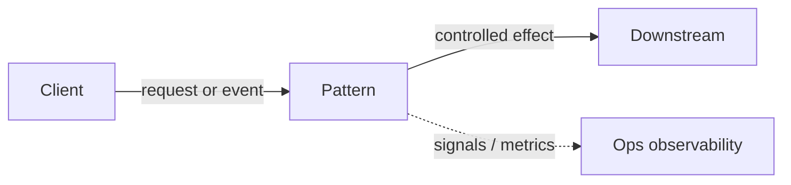

# Cache-Aside — problem and solution

## Problem and forces

Hot reads hit the database every time; latency and cost climb.

Forces typically include reliability under partial failure, operable complexity, cost of idle capacity, and security boundaries for untrusted clients or partners.

## Naive approach and why it fails

- Always query the DB; or put a cache in front with no invalidation plan.

## Solution

On read: check cache → on miss load store → populate cache. On write: update store and invalidate/update cache.

## Analogy (original)

A librarian keeps frequently asked books on a cart; restock from the stacks when the cart misses.

## Structure

| Participant | Role |
|-------------|------|
| Client / producer | Initiates work or reads |
| Pattern components | See Mermaid — names vary by pattern |
| Downstream dependency | Service, store, bus, or legacy system |

