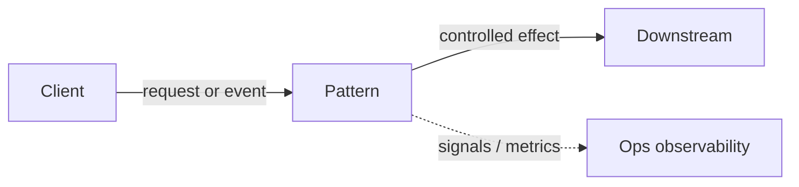

# Choreography — problem and solution

## Problem and forces

A central orchestrator becomes a bottleneck and knows every step of every flow.

Forces typically include reliability under partial failure, operable complexity, cost of idle capacity, and security boundaries for untrusted clients or partners.

## Naive approach and why it fails

- One workflow engine hard-codes every transition and owns all callbacks.

## Solution

Services publish domain events; peers subscribe and act; overall progress emerges from reactions.

## Analogy (original)

Street musicians each cue the next song from what they hear — no conductor on a podium.

## Structure

| Participant | Role |
|-------------|------|
| Client / producer | Initiates work or reads |
| Pattern components | See Mermaid — names vary by pattern |
| Downstream dependency | Service, store, bus, or legacy system |

