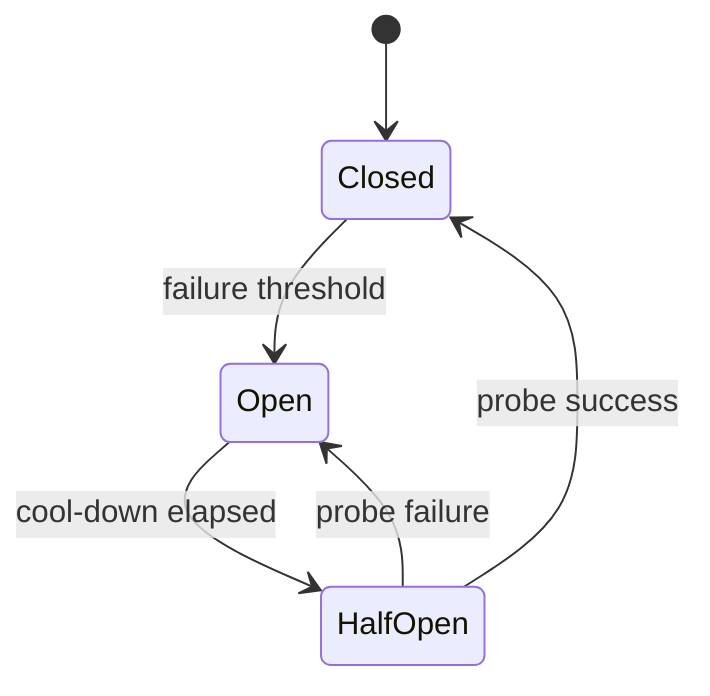

# Circuit Breaker — problem and solution

## Problem and forces

A dependency (payment API, email provider, search cluster) starts failing or slowing. Callers keep hammering it: thread pools fill, user latency spikes, cascading timeouts appear in unrelated features that share the same process or connection pool.

Forces: fail fast vs retry forever; cool-down vs permanent blackhole; shared fate of colocated workloads; observability of open/half-open state.

## Naive approach and why it fails

- Retry harder on every failure until the dependency recovers — amplifies load (retry storm).
- Catch and ignore errors — silent data loss and no operator signal.
- Global process-wide timeout with no isolation — one bad dependency freezes the whole app.

## Solution

Wrap outbound calls in a breaker that tracks recent failures (or latency). **Closed:** calls flow. **Open:** fail fast for a cool-down without touching the dependency. **Half-open:** allow a probe; success closes, failure re-opens. Combine with bounded retries *inside* closed/half-open only, and with Bulkhead so one dependency cannot exhaust all workers.

## Analogy (original)

A building electrical breaker trips when a circuit overloads. You do not keep flipping appliances on the dead circuit hoping they work — you wait, inspect, then carefully re-energize.

## Structure

| Participant | Role |
|-------------|------|
| Caller | Feature code that needs the dependency |
| Breaker | Tracks outcomes; gates calls by state |
| Dependency | External or internal service |
| Ops | Metrics/alerts on open duration and probe failures |

