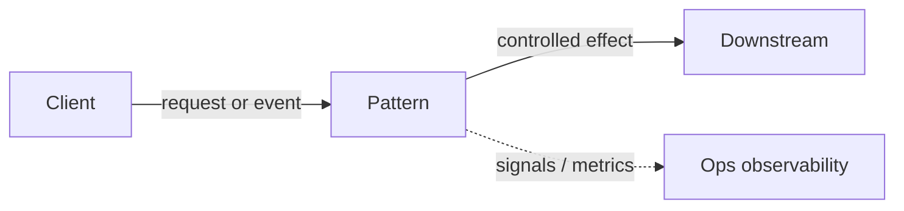

# Claim Check — problem and solution

## Problem and forces

Huge messages clog the bus, blow size limits, or leak sensitive payloads into logs.

Forces typically include reliability under partial failure, operable complexity, cost of idle capacity, and security boundaries for untrusted clients or partners.

## Naive approach and why it fails

- Put entire PDFs/blobs in every queue message.

## Solution

Upload payload to durable store; publish claim id + metadata; consumers fetch by claim.

## Analogy (original)

Coat-check ticket: the ticket is small; the coat stays in the closet until claimed.

## Structure

| Participant | Role |
|-------------|------|
| Client / producer | Initiates work or reads |
| Pattern components | See Mermaid — names vary by pattern |
| Downstream dependency | Service, store, bus, or legacy system |

