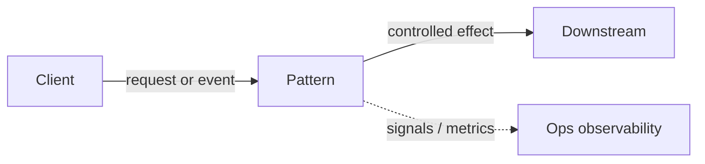

# Compensating Transaction — problem and solution

## Problem and forces

Distributed steps cannot share a classic ACID transaction; partial success leaves garbage.

Forces typically include reliability under partial failure, operable complexity, cost of idle capacity, and security boundaries for untrusted clients or partners.

## Naive approach and why it fails

- Hope all steps succeed
- Manual ops cleanup

## Solution

Define an inverse or neutralizing action per step; run compensations in reverse on failure.

## Analogy (original)

A travel agent cancels the hotel if the flight booking fails after hold.

## Structure

| Participant | Role |
|-------------|------|
| Client / producer | Initiates work or reads |
| Pattern components | See Mermaid — names vary by pattern |
| Downstream dependency | Service, store, bus, or legacy system |

