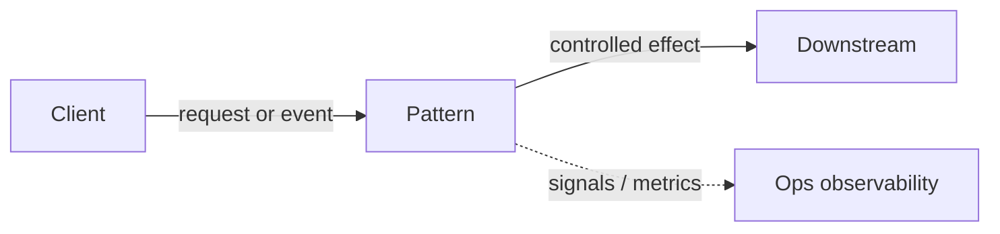

# Competing Consumers — problem and solution

## Problem and forces

One worker cannot keep up with message arrival rate.

Forces typically include reliability under partial failure, operable complexity, cost of idle capacity, and security boundaries for untrusted clients or partners.

## Naive approach and why it fails

- Single threaded consumer; backlog grows.

## Solution

N consumers race to lock/ack messages; scale horizontally; design for unordered processing unless sequenced.

## Analogy (original)

Several cashiers take the next ticket from one shared dispenser.

## Structure

| Participant | Role |
|-------------|------|
| Client / producer | Initiates work or reads |
| Pattern components | See Mermaid — names vary by pattern |
| Downstream dependency | Service, store, bus, or legacy system |

