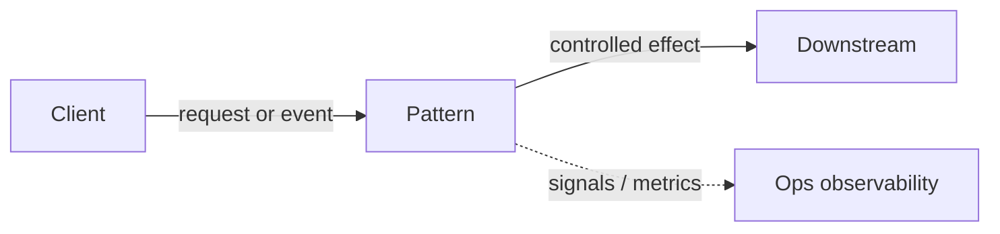

# Compute Resource Consolidation — problem and solution

## Problem and forces

Many tiny services each pay idle compute and ops tax.

Forces typically include reliability under partial failure, operable complexity, cost of idle capacity, and security boundaries for untrusted clients or partners.

## Naive approach and why it fails

- Microservice per function regardless of load.

## Solution

Colocate related workloads in one process/container/VM with clear module boundaries.

## Analogy (original)

A food-truck kitchen shares one grill for several menu items instead of three trucks.

## Structure

| Participant | Role |
|-------------|------|
| Client / producer | Initiates work or reads |
| Pattern components | See Mermaid — names vary by pattern |
| Downstream dependency | Service, store, bus, or legacy system |

