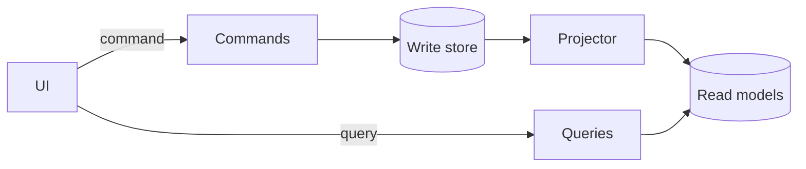

# CQRS — problem and solution

## Problem and forces

Write models optimized for invariants fight read models optimized for screens and reports. One schema forced to do both becomes slow, tangled, or unsafe.

Forces: consistency lag on reads; dual-model ownership; learning cost; when a modular monolith already separates commands/queries enough.

## Naive approach and why it fails

- One fat model for every screen and every write — N+1 and god services.
- Microservices “because CQRS” without a read/write pain — distribution without need.

## Solution

Separate **command** (change state under invariants) from **query** (read shaped projections). Sync projections via events, outbox, or async workers. Start in-process (two modules, one DB) before splitting networks. Pair with Materialized View / Event Sourcing only when earned.

## Analogy (original)

A warehouse has a receiving dock (writes with checks) and a showroom (reads). You do not make shoppers walk the loading bay to see what’s in stock — you update the showroom displays from receiving events.

## Structure

| Participant | Role |
|-------------|------|
| Command side | Validates and persists writes |
| Query side | Serves read models |
| Projector | Updates reads from write events |

