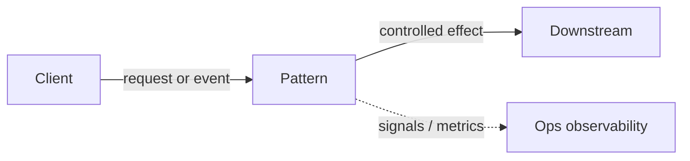

# Deployment Stamps — problem and solution

## Problem and forces

A single deployment cannot scale, update, or isolate tenants safely.

Forces typically include reliability under partial failure, operable complexity, cost of idle capacity, and security boundaries for untrusted clients or partners.

## Naive approach and why it fails

- Vertical scale forever
- One cluster for the world

## Solution

Stamp = complete vertical slice; route tenants/regions to stamps; deploy/upgrade per stamp.

## Analogy (original)

Franchise kitchens: each location is a full kitchen, not one mega-kitchen for every city.

## Structure

| Participant | Role |
|-------------|------|
| Client / producer | Initiates work or reads |
| Pattern components | See Mermaid — names vary by pattern |
| Downstream dependency | Service, store, bus, or legacy system |

