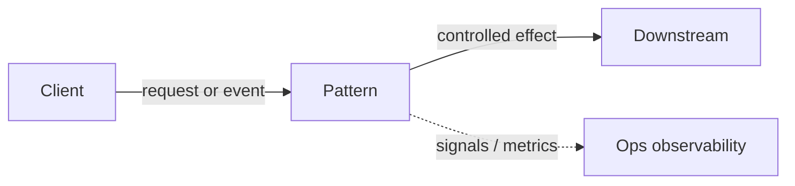

# Event Sourcing — problem and solution

## Problem and forces

You need audit, time-travel, or rebuildable projections; current-state rows erase history.

Forces typically include reliability under partial failure, operable complexity, cost of idle capacity, and security boundaries for untrusted clients or partners.

## Naive approach and why it fails

- Overwrite rows; maintain ad-hoc audit tables that drift.

## Solution

Store events as source of truth; project read models; snapshots optional for speed.

## Analogy (original)

A bank ledger of postings, not a sticky note of “current balance only.”

## Structure

| Participant | Role |
|-------------|------|
| Client / producer | Initiates work or reads |
| Pattern components | See Mermaid — names vary by pattern |
| Downstream dependency | Service, store, bus, or legacy system |

