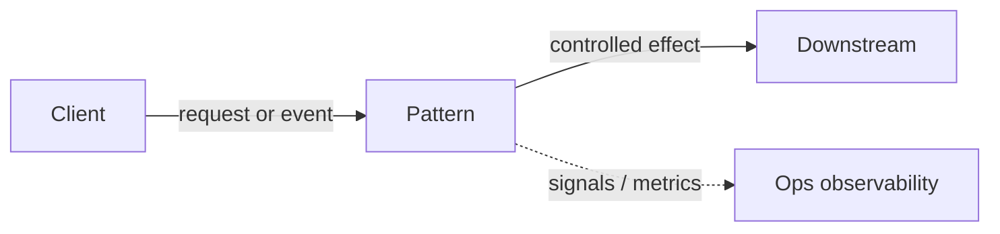

# External Configuration Store — problem and solution

## Problem and forces

Config baked into images forces redeploy for every toggle; environments drift in code.

Forces typically include reliability under partial failure, operable complexity, cost of idle capacity, and security boundaries for untrusted clients or partners.

## Naive approach and why it fails

- Hardcode
- Ship .env inside the artifact only

## Solution

Central store (or platform config) with hierarchy, secrets separation, and refresh strategy.

## Analogy (original)

Theater lighting cues live on the board, not painted onto the stage set.

## Structure

| Participant | Role |
|-------------|------|
| Client / producer | Initiates work or reads |
| Pattern components | See Mermaid — names vary by pattern |
| Downstream dependency | Service, store, bus, or legacy system |

