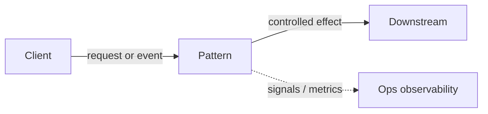

# Federated Identity — problem and solution

## Problem and forces

App-built login duplicates MFA, recovery, and compliance work poorly.

Forces typically include reliability under partial failure, operable complexity, cost of idle capacity, and security boundaries for untrusted clients or partners.

## Naive approach and why it fails

- Roll your own password DB without expertise.

## Solution

OIDC/SAML (or platform auth) issues tokens; app authorizes on claims/roles.

## Analogy (original)

A venue trusts stadium season-pass scanners instead of issuing its own IDs at every door.

## Structure

| Participant | Role |
|-------------|------|
| Client / producer | Initiates work or reads |
| Pattern components | See Mermaid — names vary by pattern |
| Downstream dependency | Service, store, bus, or legacy system |

