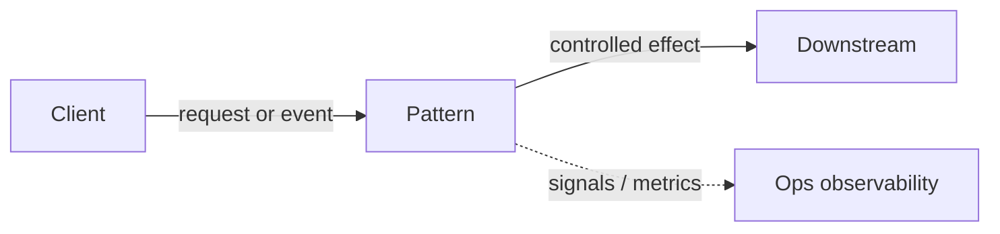

# Gatekeeper — problem and solution

## Problem and forces

Public internet traffic hits private services directly; attack surface is huge.

Forces typically include reliability under partial failure, operable complexity, cost of idle capacity, and security boundaries for untrusted clients or partners.

## Naive approach and why it fails

- Expose every microservice; validate deep inside each.

## Solution

Dedicated gatekeeper validates authz, schema, size; only then forwards to private hosts.

## Analogy (original)

Museum bag check at the entrance — galleries stay beyond the checkpoint.

## Structure

| Participant | Role |
|-------------|------|
| Client / producer | Initiates work or reads |
| Pattern components | See Mermaid — names vary by pattern |
| Downstream dependency | Service, store, bus, or legacy system |

