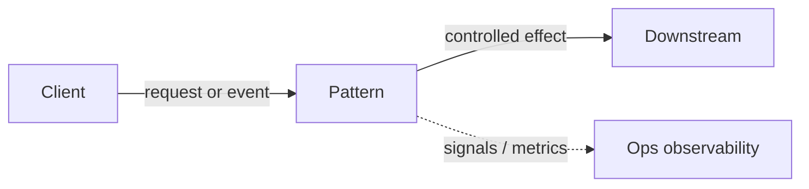

# Gateway Aggregation — problem and solution

## Problem and forces

Chatty clients make many sequential calls over high latency links.

Forces typically include reliability under partial failure, operable complexity, cost of idle capacity, and security boundaries for untrusted clients or partners.

## Naive approach and why it fails

- Mobile app calls N services serially.

## Solution

Gateway issues parallel/sequential backend calls and returns one response.

## Analogy (original)

A hotel concierge gathers tickets, maps, and keys into one envelope for the guest.

## Structure

| Participant | Role |
|-------------|------|
| Client / producer | Initiates work or reads |
| Pattern components | See Mermaid — names vary by pattern |
| Downstream dependency | Service, store, bus, or legacy system |

