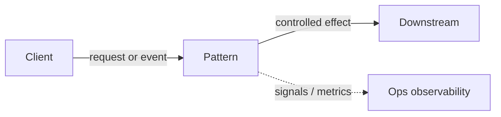

# Gateway Offloading — problem and solution

## Problem and forces

Every service reimplements cross-cutting edge features inconsistently.

Forces typically include reliability under partial failure, operable complexity, cost of idle capacity, and security boundaries for untrusted clients or partners.

## Naive approach and why it fails

- Copy TLS and auth into each service.

## Solution

Gateway terminates TLS, applies shared filters; services focus on domain.

## Analogy (original)

Airport security and baggage screening happen once before every gate.

## Structure

| Participant | Role |
|-------------|------|
| Client / producer | Initiates work or reads |
| Pattern components | See Mermaid — names vary by pattern |
| Downstream dependency | Service, store, bus, or legacy system |

