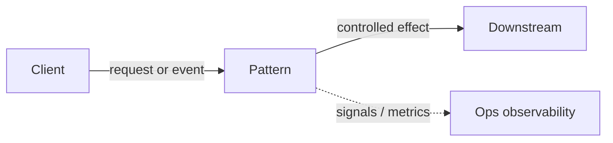

# Gateway Routing — problem and solution

## Problem and forces

Clients must know many service addresses and versions.

Forces typically include reliability under partial failure, operable complexity, cost of idle capacity, and security boundaries for untrusted clients or partners.

## Naive approach and why it fails

- Hardcode URLs in apps
- DNS sprawl

## Solution

Gateway maps routes to backends; clients see a stable façade.

## Analogy (original)

A building lobby directory sends visitors to the right floor from one entrance.

## Structure

| Participant | Role |
|-------------|------|
| Client / producer | Initiates work or reads |
| Pattern components | See Mermaid — names vary by pattern |
| Downstream dependency | Service, store, bus, or legacy system |

