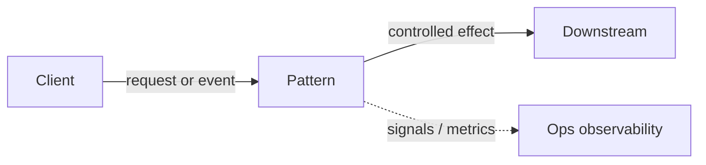

# Geode — problem and solution

## Problem and forces

Users worldwide need low latency and regional survival without sticky single-home routing only.

Forces typically include reliability under partial failure, operable complexity, cost of idle capacity, and security boundaries for untrusted clients or partners.

## Naive approach and why it fails

- One region
- Active/passive DR only

## Solution

Replicated geodes; traffic managers; data strategies that allow multi-read or conflict rules.

## Analogy (original)

Mirror telescopes: any dish can catch the signal depending on the sky.

## Structure

| Participant | Role |
|-------------|------|
| Client / producer | Initiates work or reads |
| Pattern components | See Mermaid — names vary by pattern |
| Downstream dependency | Service, store, bus, or legacy system |

