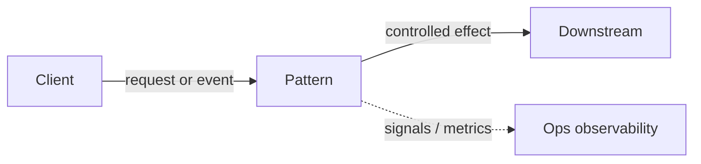

# Health Endpoint Monitoring — problem and solution

## Problem and forces

Load balancers keep sending traffic to broken instances; outages linger.

Forces typically include reliability under partial failure, operable complexity, cost of idle capacity, and security boundaries for untrusted clients or partners.

## Naive approach and why it fails

- Process up = healthy
- No deep dependency checks

## Solution

Liveness vs readiness endpoints; check critical dependencies thoughtfully; alert on fail.

## Analogy (original)

A pilot’s preflight checklist before passengers board — not just “engine makes noise.”

## Structure

| Participant | Role |
|-------------|------|
| Client / producer | Initiates work or reads |
| Pattern components | See Mermaid — names vary by pattern |
| Downstream dependency | Service, store, bus, or legacy system |

