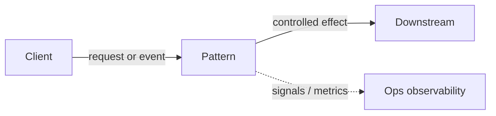

# Idempotent Consumer — problem and solution

## Problem and forces

At-least-once delivery redelivers; naïve consumers double-charge or double-write.

Forces typically include reliability under partial failure, operable complexity, cost of idle capacity, and security boundaries for untrusted clients or partners.

## Naive approach and why it fails

- Assume exactly-once
- No dedupe store

## Solution

Idempotency keys / dedupe table / natural keys; acknowledge after durable effect.

## Analogy (original)

A turnstile ignores a second tap of the same ticket barcode.

## Structure

| Participant | Role |
|-------------|------|
| Client / producer | Initiates work or reads |
| Pattern components | See Mermaid — names vary by pattern |
| Downstream dependency | Service, store, bus, or legacy system |

