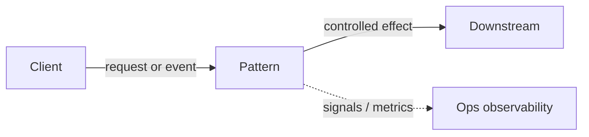

# Index Table — problem and solution

## Problem and forces

Primary key access is fine; queries by other attributes scan or fan out painfully.

Forces typically include reliability under partial failure, operable complexity, cost of idle capacity, and security boundaries for untrusted clients or partners.

## Naive approach and why it fails

- Full scans
- Duplicate entire entities per query

## Solution

Separate index records mapping attribute → primary key(s); update indexes on write.

## Analogy (original)

A library card catalog by author and by subject pointing to the same shelf code.

## Structure

| Participant | Role |
|-------------|------|
| Client / producer | Initiates work or reads |
| Pattern components | See Mermaid — names vary by pattern |
| Downstream dependency | Service, store, bus, or legacy system |

