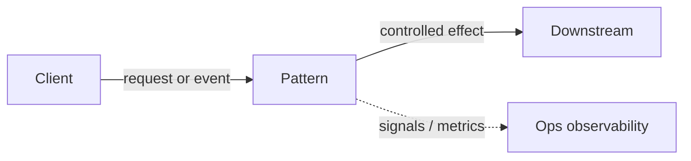

# Leader Election — problem and solution

## Problem and forces

Multiple instances must not all run the same singleton task (scheduler, partition owner).

Forces typically include reliability under partial failure, operable complexity, cost of idle capacity, and security boundaries for untrusted clients or partners.

## Naive approach and why it fails

- All run it
- Manual primary

## Solution

Consensus/lease-based election; leader does coordinated work; re-elect on failure.

## Analogy (original)

A hiking group picks one navigator; if they drop out, the group elects another.

## Structure

| Participant | Role |
|-------------|------|
| Client / producer | Initiates work or reads |
| Pattern components | See Mermaid — names vary by pattern |
| Downstream dependency | Service, store, bus, or legacy system |

