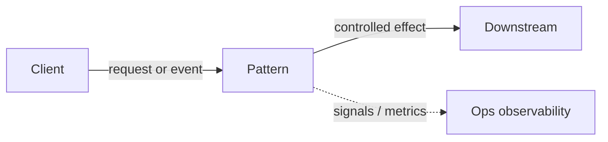

# Materialized View — problem and solution

## Problem and forces

Runtime joins/aggregations are too slow or impossible across stores.

Forces typically include reliability under partial failure, operable complexity, cost of idle capacity, and security boundaries for untrusted clients or partners.

## Naive approach and why it fails

- Compute on every read
- Denormalize ad hoc in app without refresh rules

## Solution

Maintain a stored view updated on write/events; serve reads from the view.

## Analogy (original)

A restaurant prep board lists today’s specials so servers do not recount the walk-in each time.

## Structure

| Participant | Role |
|-------------|------|
| Client / producer | Initiates work or reads |
| Pattern components | See Mermaid — names vary by pattern |
| Downstream dependency | Service, store, bus, or legacy system |

