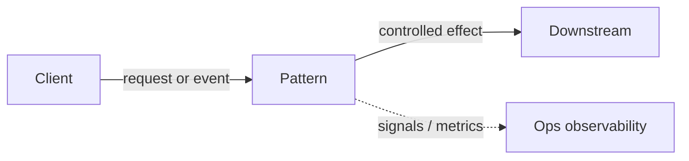

# Messaging Bridge — problem and solution

## Problem and forces

Team A’s bus cannot talk to Team B’s bus (protocols, clouds, on-prem).

Forces typically include reliability under partial failure, operable complexity, cost of idle capacity, and security boundaries for untrusted clients or partners.

## Naive approach and why it fails

- Dual-write from producers
- Point-to-point adapters everywhere

## Solution

Bridge consumes from one system and publishes to the other with mapping and durability.

## Analogy (original)

A railroad gauge-change facility moves cargo between incompatible tracks.

## Structure

| Participant | Role |
|-------------|------|
| Client / producer | Initiates work or reads |
| Pattern components | See Mermaid — names vary by pattern |
| Downstream dependency | Service, store, bus, or legacy system |

