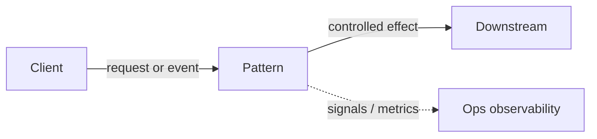

# Pipes and Filters — problem and solution

## Problem and forces

Monolithic processors mix unrelated stages; reuse and scale-per-stage suffer.

Forces typically include reliability under partial failure, operable complexity, cost of idle capacity, and security boundaries for untrusted clients or partners.

## Naive approach and why it fails

- One giant function does validate → transform → enrich → store.

## Solution

Independent filters; messages flow through pipes; scale or swap stages independently.

## Analogy (original)

An assembly line: each station does one job; belts move the unit forward.

## Structure

| Participant | Role |
|-------------|------|
| Client / producer | Initiates work or reads |
| Pattern components | See Mermaid — names vary by pattern |
| Downstream dependency | Service, store, bus, or legacy system |

