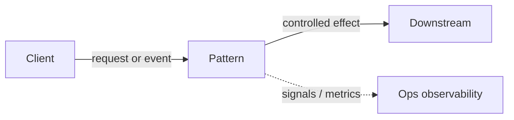

# Priority Queue — problem and solution

## Problem and forces

FIFO queues starve urgent work behind bulk jobs.

Forces typically include reliability under partial failure, operable complexity, cost of idle capacity, and security boundaries for untrusted clients or partners.

## Naive approach and why it fails

- One FIFO queue
- Separate apps without priority

## Solution

Priority queues or multiple queues with weighted consumers; define starvation policy.

## Analogy (original)

ER triage: critical patients before paperwork visits.

## Structure

| Participant | Role |
|-------------|------|
| Client / producer | Initiates work or reads |
| Pattern components | See Mermaid — names vary by pattern |
| Downstream dependency | Service, store, bus, or legacy system |

