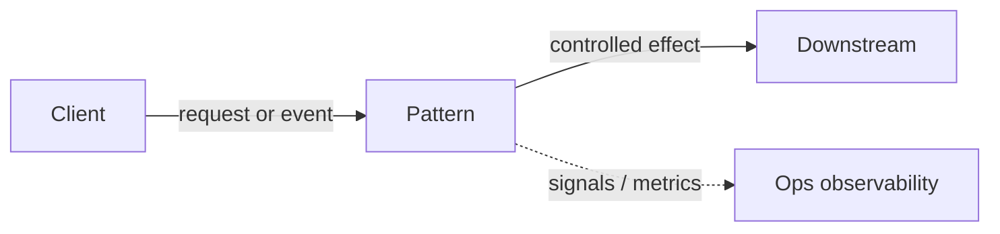

# Publisher-Subscriber — problem and solution

## Problem and forces

Producers hard-code lists of consumers; adding a listener requires editing the producer.

Forces typically include reliability under partial failure, operable complexity, cost of idle capacity, and security boundaries for untrusted clients or partners.

## Naive approach and why it fails

- Direct calls to each consumer
- Shared DB as signal

## Solution

Topic/bus; subscribers attach independently; delivery semantics documented.

## Analogy (original)

A newsletter: writers publish once; readers subscribe or unsubscribe freely.

## Structure

| Participant | Role |
|-------------|------|
| Client / producer | Initiates work or reads |
| Pattern components | See Mermaid — names vary by pattern |
| Downstream dependency | Service, store, bus, or legacy system |

