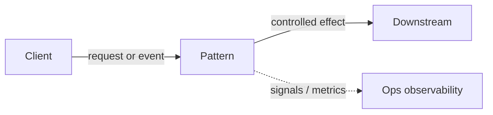

# Quarantine — problem and solution

## Problem and forces

Untrusted uploads or dependencies enter production paths unchecked.

Forces typically include reliability under partial failure, operable complexity, cost of idle capacity, and security boundaries for untrusted clients or partners.

## Naive approach and why it fails

- Serve uploads immediately
- npm install without review gates

## Solution

Landing zone → scan/validate → promote; reject or isolate failures.

## Analogy (original)

Customs holds parcels for inspection before they enter the warehouse floor.

## Structure

| Participant | Role |
|-------------|------|
| Client / producer | Initiates work or reads |
| Pattern components | See Mermaid — names vary by pattern |
| Downstream dependency | Service, store, bus, or legacy system |

