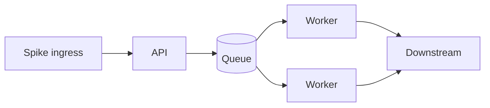

# Queue-Based Load Leveling — problem and solution

## Problem and forces

Ingress spikes (uploads, webhooks, report requests) exceed what processors can finish in real time. Synchronous handling times out or autoscales wastefully.

Forces: acceptable lag; poison messages; duplicate delivery; cost of always-on peak capacity.

## Naive approach and why it fails

- Autoscale application servers on every spike with heavy inline work — cost and cold starts.
- Drop or timeout requests under load — user-visible failure for work that could wait.

## Solution

Accept work quickly onto a durable queue; process at a steady consumer rate (scale consumers independently). Return 202/accepted with a status URL when the user must track progress (Asynchronous Request-Reply). Pair with Competing Consumers for throughput and Idempotent Consumer for at-least-once buses.

## Analogy (original)

A ticket window takes coats into a cloakroom faster than attendants hang them — the queue is the cloakroom rail; attendants work at a sustainable pace.

## Structure

| Participant | Role |
|-------------|------|
| Producer / API | Enqueues; responds fast |
| Queue | Absorbs spikes |
| Consumers | Drain at controlled rate |

