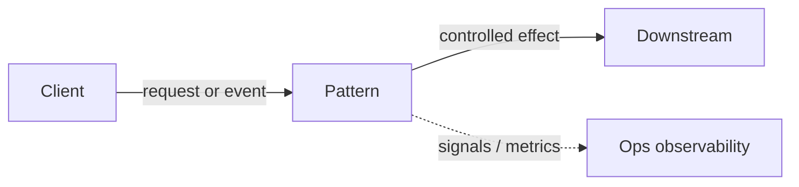

# Rate Limiting — problem and solution

## Problem and forces

Abusive or buggy clients exhaust shared capacity.

Forces typically include reliability under partial failure, operable complexity, cost of idle capacity, and security boundaries for untrusted clients or partners.

## Naive approach and why it fails

- Infinite capacity assumption
- Only scale out

## Solution

Token bucket / sliding window limits; Return 429 with retry hints; Per-key budgets

## Analogy (original)

A turnstile admits one person per click — crowds wait their turn.

## Structure

| Participant | Role |
|-------------|------|
| Client / producer | Initiates work or reads |
| Pattern components | See Mermaid — names vary by pattern |
| Downstream dependency | Service, store, bus, or legacy system |

