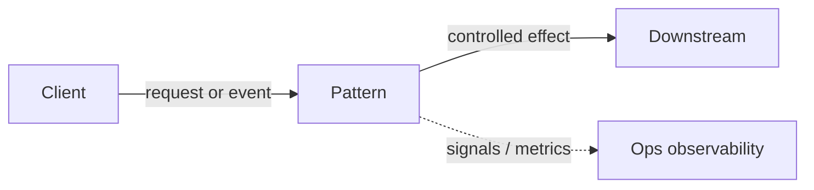

# Retry — problem and solution

## Problem and forces

Blips (network, throttles) cause unnecessary user-visible failures.

Forces typically include reliability under partial failure, operable complexity, cost of idle capacity, and security boundaries for untrusted clients or partners.

## Naive approach and why it fails

- Fail once
- Retry storms without jitter

## Solution

Detect transient errors; exponential backoff + jitter; cap attempts; idempotent ops.

## Analogy (original)

Redialing a busy phone line a few times — not calling a disconnected number forever.

## Structure

| Participant | Role |
|-------------|------|
| Client / producer | Initiates work or reads |
| Pattern components | See Mermaid — names vary by pattern |
| Downstream dependency | Service, store, bus, or legacy system |

