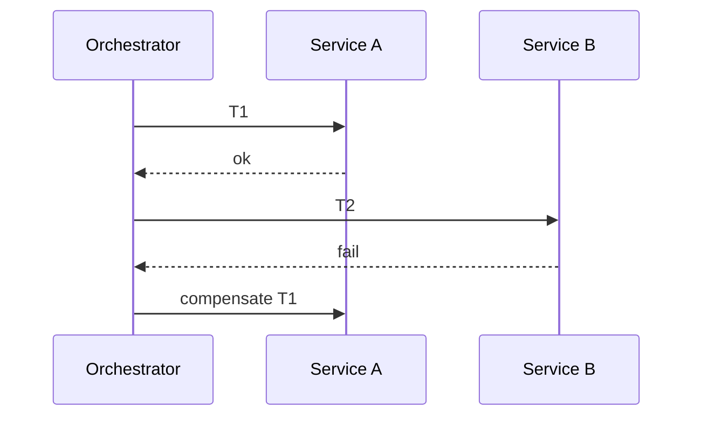

# Saga — problem and solution

## Problem and forces

A business action spans multiple services or databases (reserve inventory, charge card, schedule shipment). Classic ACID across those boundaries is unavailable or toxic (2PC latency, availability coupling).

Forces: eventual consistency vs user-visible partial states; compensation safety; idempotent steps; who owns the workflow (orchestrator vs choreography).

## Naive approach and why it fails

- Distributed two-phase commit across every service — availability and ops cost explode.
- Fire steps with no undo plan — operators clean up by hand after every partial failure.
- One giant shared database “so we can transaction” — fake distribution; coupling returns.

## Solution

Model the action as a sequence of **local transactions** plus either:
- **Orchestration:** a supervisor advances steps and triggers compensations on failure, or
- **Choreography:** each service emits events; peers react (see Choreography pack).

Every step must be idempotent or guarded; every forward step that can fail mid-flight needs a compensating action (see Compensating Transaction). Persist saga state so restarts resume instead of double-charging.

## Analogy (original)

A multi-city trip: book flight, then hotel, then transfer. If the hotel fails after the flight is held, the agent cancels the flight hold — not by inventing a global “trip lock” across airlines and hotels.

## Structure

| Participant | Role |
|-------------|------|
| Orchestrator (optional) | Drives steps and compensations |
| Participants | Local transactions + compensate |
| Saga store | Durable progress / correlation id |

