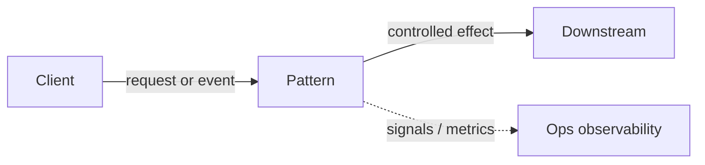

# Scheduler Agent Supervisor — problem and solution

## Problem and forces

Distributed multi-step tasks fail silently without ownership of recovery.

Forces typically include reliability under partial failure, operable complexity, cost of idle capacity, and security boundaries for untrusted clients or partners.

## Naive approach and why it fails

- Cron only
- No supervisor

## Solution

Scheduler creates jobs; agents execute; supervisor tracks leases/timeouts and retries/compensates.

## Analogy (original)

A film shoot: AD schedules, camera crews shoot, producer reshoots missed takes.

## Structure

| Participant | Role |
|-------------|------|
| Client / producer | Initiates work or reads |
| Pattern components | See Mermaid — names vary by pattern |
| Downstream dependency | Service, store, bus, or legacy system |

