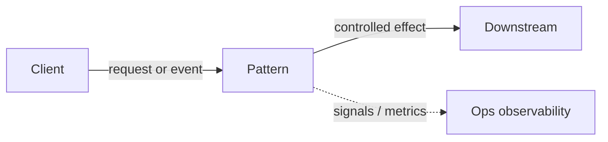

# Sequential Convoy — problem and solution

## Problem and forces

FIFO-all-queue destroys throughput; unordered processing breaks entity invariants.

Forces typically include reliability under partial failure, operable complexity, cost of idle capacity, and security boundaries for untrusted clients or partners.

## Naive approach and why it fails

- Global FIFO
- No ordering

## Solution

Partition by correlation key; preserve order within key; parallelize across keys.

## Analogy (original)

Toll booths: cars in one lane keep order; other lanes move independently.

## Structure

| Participant | Role |
|-------------|------|
| Client / producer | Initiates work or reads |
| Pattern components | See Mermaid — names vary by pattern |
| Downstream dependency | Service, store, bus, or legacy system |

