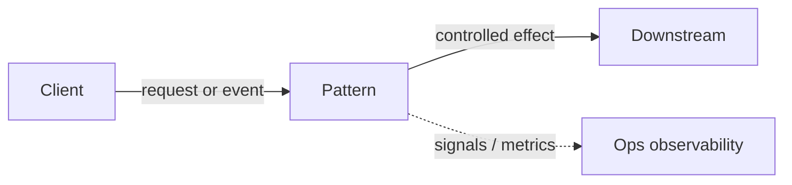

# Sharding — problem and solution

## Problem and forces

One store hits storage/IOPS/size limits or noisy-neighbor effects.

Forces typically include reliability under partial failure, operable complexity, cost of idle capacity, and security boundaries for untrusted clients or partners.

## Naive approach and why it fails

- Vertical scale only
- Random split without key strategy

## Solution

Choose shard key; route reads/writes; plan rebalancing and cross-shard queries carefully.

## Analogy (original)

A library opens branch rooms by last-name ranges instead of one endless shelf.

## Structure

| Participant | Role |
|-------------|------|
| Client / producer | Initiates work or reads |
| Pattern components | See Mermaid — names vary by pattern |
| Downstream dependency | Service, store, bus, or legacy system |

