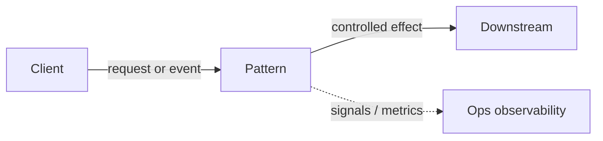

# Sidecar — problem and solution

## Problem and forces

Cross-cutting features pollute app code or cannot be updated independently.

Forces typically include reliability under partial failure, operable complexity, cost of idle capacity, and security boundaries for untrusted clients or partners.

## Naive approach and why it fails

- Bake everything into the app binary
- Remote calls for every log line

## Solution

Colocate sidecar sharing fate/network; app talks via localhost; ship sidecar updates separately when safe.

## Analogy (original)

A motorcycle sidecar: same trip, separate seat and toolkit.

## Structure

| Participant | Role |
|-------------|------|
| Client / producer | Initiates work or reads |
| Pattern components | See Mermaid — names vary by pattern |
| Downstream dependency | Service, store, bus, or legacy system |

