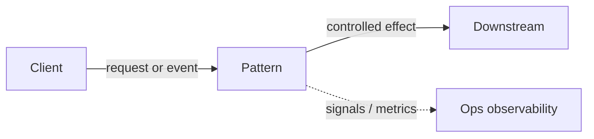

# Static Content Hosting — problem and solution

## Problem and forces

App servers waste CPU/bandwidth on images, JS, docs.

Forces typically include reliability under partial failure, operable complexity, cost of idle capacity, and security boundaries for untrusted clients or partners.

## Naive approach and why it fails

- Serve /public from app pods
- No CDN

## Solution

Put static files on storage + CDN; app emits URLs; cache headers tuned.

## Analogy (original)

Posters hang in the lobby racks — not printed by the receptionist for every guest.

## Structure

| Participant | Role |
|-------------|------|
| Client / producer | Initiates work or reads |
| Pattern components | See Mermaid — names vary by pattern |
| Downstream dependency | Service, store, bus, or legacy system |

