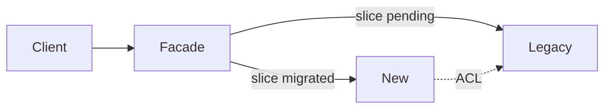

# Strangler Fig — problem and solution

## Problem and forces

A legacy system must be replaced, but a big-bang cutover is too risky (data, traffic, team knowledge). New work must ship while old paths still serve users.

Forces: dual-running cost; routing correctness; shared data traps; team skill split; rollback.

## Naive approach and why it fails

- Rewrite everything offline for months, then flip DNS — years of dark code, one catastrophic night.
- Freeze the legacy forever and bolt features on the side — technical debt compounds.

## Solution

Put a routing façade (gateway, reverse proxy, or BFF) in front. Migrate **vertical slices** (one capability at a time) to the new system. Route those slices to new; leave the rest on legacy. Expand until legacy is empty, then remove the façade’s legacy branches. Pair with Anti-Corruption Layer so legacy models do not infect the new domain.

## Analogy (original)

A strangler fig grows around a host tree, taking over canopy by canopy until the host is gone — not by chopping the whole forest overnight.

## Structure

| Participant | Role |
|-------------|------|
| Façade / gateway | Chooses legacy vs new per route or feature flag |
| Legacy | Shrinking surface |
| New system | Growing surface |
| ACL | Translates at the boundary |

