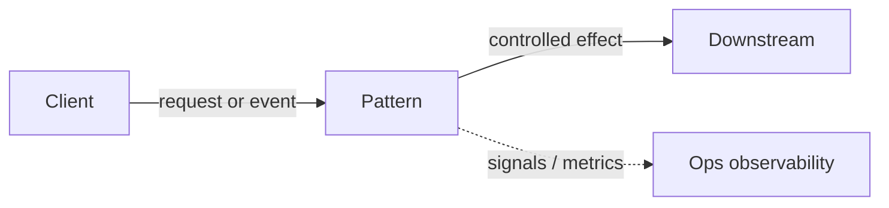

# Throttling — problem and solution

## Problem and forces

Uncontrolled load causes total outage instead of graceful degradation.

Forces typically include reliability under partial failure, operable complexity, cost of idle capacity, and security boundaries for untrusted clients or partners.

## Naive approach and why it fails

- Accept all work
- Only scale reactively

## Solution

Reject/slow excess (shed load); protect critical paths; communicate limits.

## Analogy (original)

A nightclub capacity count — when full, the door stops entry so exits stay safe.

## Structure

| Participant | Role |
|-------------|------|
| Client / producer | Initiates work or reads |
| Pattern components | See Mermaid — names vary by pattern |
| Downstream dependency | Service, store, bus, or legacy system |

