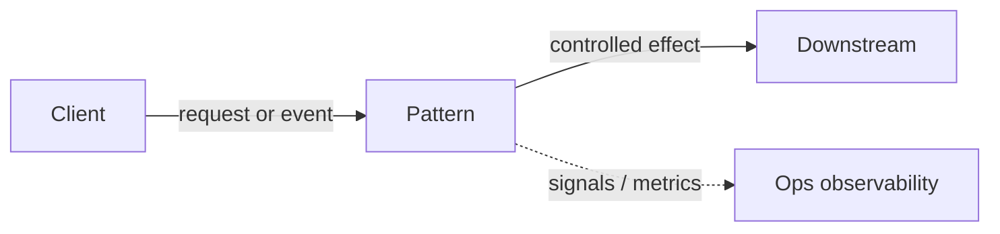

# Valet Key — problem and solution

## Problem and forces

Proxying large blobs through the app burns bandwidth and becomes a bottleneck.

Forces typically include reliability under partial failure, operable complexity, cost of idle capacity, and security boundaries for untrusted clients or partners.

## Naive approach and why it fails

- App streams every file
- Public buckets

## Solution

App authorizes then mints scoped key; client talks to storage; key expires.

## Analogy (original)

A valet key starts the car but does not open the glove box.

## Structure

| Participant | Role |
|-------------|------|
| Client / producer | Initiates work or reads |
| Pattern components | See Mermaid — names vary by pattern |
| Downstream dependency | Service, store, bus, or legacy system |

