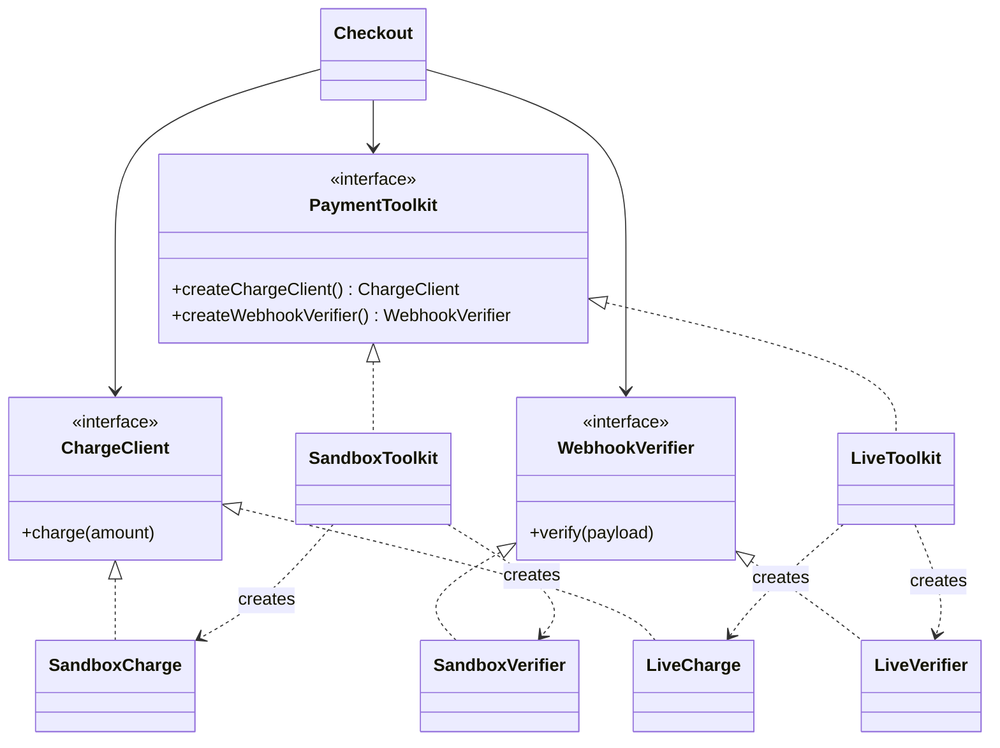

# Abstract Factory — problem and solution

## Problem and forces

Checkout, notification suites, and file-export themes often need **more than one** collaborator, and those collaborators must agree on protocol, credentials, and message shape. Forces:

- Clients (checkout service, outbox worker) should not import concrete provider SDKs.
- Mixing products from different families causes subtle production failures.
- Adding a new provider should add one factory, not edit every `new` site.

## Naive approach and why it fails

Construct each collaborator independently: `new ProviderAChargeClient()`, `new ProviderBWebhookVerifier()`. Or use separate Factory Methods that can be configured to disagree. Tests pass with mixed fakes that could never coexist in production. A new provider means hunting every construction site.

## Solution

Define product interfaces for each role (`ChargeClient`, `WebhookVerifier`, `RefundClient`). Define an **abstract factory** interface with one creation method per role. Each concrete factory returns a complete, matching set for one family. Clients receive the factory (or the products it built at the composition root) and never name concrete products.

## Analogy (original)

A payment-provider adapter is like a sealed toolkit drawer. One drawer holds “sandbox charge client + sandbox webhook verifier + sandbox refund client.” Another drawer holds the live set. The checkout desk asks for *a drawer*, not three unrelated tools from different drawers. Abstract Factory is the rule that you only ever open one drawer at a time.

## Structure

| Participant | Role |
|-------------|------|
| AbstractProductA/B | Role contracts (`ChargeClient`, `WebhookVerifier`) |
| ConcreteProductA1/B1… | Family members that work together |
| AbstractFactory | Declares `createChargeClient()`, `createWebhookVerifier()`, … |
| ConcreteFactory | Returns one complete family |
| Client | Uses products through interfaces; holds a factory or injected products |

