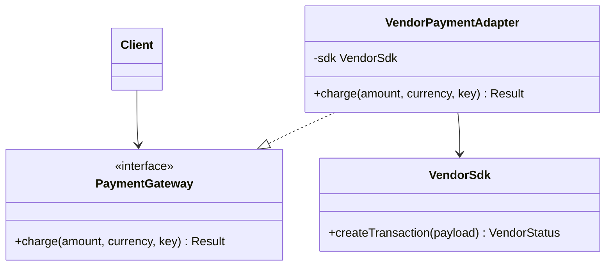

# Adapter — problem and solution

## Problem and forces

Checkout (or notification dispatch, or file export) depends on a `PaymentGateway` port: `charge(amount, currency, idempotencyKey)`. The new provider's SDK exposes `createTransaction({ cents, isoCurrency, requestId })` and returns a different status vocabulary. Forces: keep the domain port stable, isolate SDK churn, keep tests free of vendor types, avoid scattering conversion logic.

## Naive approach and why it fails

Call the SDK directly from every use case, or sprinkle `toVendorPayload` helpers next to each call. Fails when a second provider arrives, when the SDK renames fields, or when tests must mock three different foreign shapes instead of one port.

## Solution

Introduce an Adapter that implements the domain port and holds the foreign client. Each port method maps arguments in, maps results (and errors) out. Clients keep depending only on the port.

## Analogy (original)

A newsroom style desk accepts submissions only as a one-page brief. A freelance photographer delivers RAW files with EXIF dumps. An assignment editor (the adapter) turns each delivery into the brief form so every desk editor keeps the same intake ritual.

## Structure

| Participant | Role |
|-------------|------|
| Client | Calls the Target port |
| Target | Domain interface the client already knows |
| Adaptee | Foreign class or SDK with an incompatible API |
| Adapter | Implements Target; translates to/from Adaptee |

