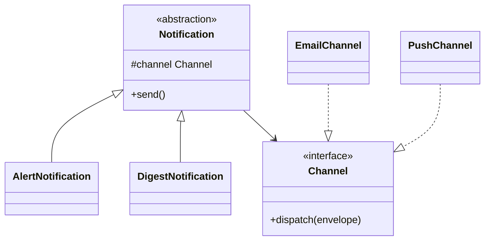

# Bridge — problem and solution

## Problem and forces

A notification module defines rich operations: build payload, apply quiet hours, enqueue. Delivery must work over email, push, and webhook — each with its own client and retry rules. Forces: avoid an N×M subclass grid, let new channels land without editing every notification kind, keep kind-level logic free of transport details.

## Naive approach and why it fails

Subclass per combination (`AlertEmailSender`, `DigestPushSender`, …) or embed `if (channel)` inside every kind. Fails when a new channel forces edits across every kind class, and when tests cannot swap transport without subclassing the kind.

## Solution

Define a refined Abstraction (notification kinds) that holds a reference to an Implementor (channel). Abstractions call `implementor.dispatch(envelope)`. Concrete channels implement that port. Both hierarchies extend independently.

## Analogy (original)

A classroom lesson plan (abstraction) lists activities and timing. The delivery medium — live board, recorded video, or printed worksheet — is chosen separately (implementor). Teachers rewrite plans without rewriting media tooling, and media teams ship a new format without rewriting every lesson.

## Structure

| Participant | Role |
|-------------|------|
| Abstraction | High-level API; holds Implementor |
| RefinedAbstraction | Specialized high-level behavior |
| Implementor | Low-level operations port |
| ConcreteImplementor | One transport or engine |

