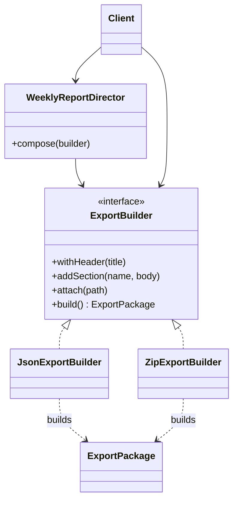

# Builder — problem and solution

## Problem and forces

File export and document assembly often need a header, optional sections, attachments, and a footer — not every export wants every section, and order matters for correctness. Forces:

- Call sites should not pass ten nullable arguments.
- Invalid partial objects must not escape (export without required header).
- The same steps might render as different formats (structured JSON vs archived files).

## Naive approach and why it fails

Telescoping constructors (`new Export(a)`, `new Export(a,b)`, …) or a god constructor with a dozen optionals. Callers skip required steps silently. Changing format duplicates the whole construction block. Mutable “set everything then hope” objects leak half-built state into workers.

## Solution

Introduce a **builder** that exposes intentional steps (`withHeader`, `addSection`, `attachFile`, `build`). Optionally a **director** encodes a standard recipe (weekly report). The builder validates on `build()` and returns an immutable (or clearly finished) product. Different builder implementations can emit different representations while sharing the director’s recipe.

## Analogy (original)

Building a file-export package is like packing a shipping crate with a checklist: label first, then items, then seal. You do not throw everything through one overloaded doorway. The checklist (director) can stay the same while the crate type (builder) changes — flat folder versus compressed archive — as long as each step has a place on the checklist.

## Structure

| Participant | Role |
|-------------|------|
| Product | Finished object (`ExportPackage`, `HttpRequest`) |
| Builder | Step API + `build()` |
| ConcreteBuilder | Accumulates state; may target one representation |
| Director (optional) | Runs a fixed sequence of steps on a builder |
| Client | Chooses builder (and director); receives the product |

