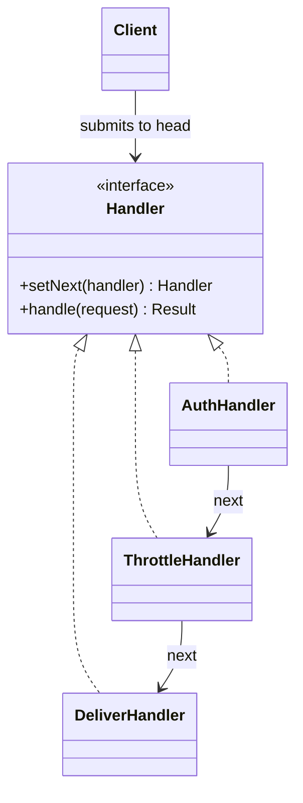

# Chain of Responsibility — problem and solution

## Problem and forces

An inbound request (HTTP call, queued notification, export job kickoff) must pass through several optional gates: authenticate, throttle, strip PII, choose a channel, then deliver. Forces collide:

- The entry point must stay thin — it should not name every gate.
- Gates must be reorderable and individually testable.
- A gate may stop the chain (reject) or pass the request onward; callers must not care which concrete gate decides.

## Naive approach and why it fails

Nest conditionals inside one controller or service: `if (!auth) …; if (rateLimited) …; if (needsSanitize) …; send()`. Adding a new gate edits the same method. Order becomes tribal knowledge in comments. Tests either exercise the whole nest or duplicate branches in fixtures. Coupling grows: every gate knows about the others because they share one procedural body.

## Solution

Give each gate the same handler contract: accept a request (and optionally a `next` continuation). Link handlers into a chain (or register them in an ordered pipeline that *behaves* as a chain). The sender hands the request to the head. Each handler either handles/short-circuits or forwards. Clients depend only on the head’s interface, not on the cast of handlers.

## Analogy (original)

A payment-provider adapter’s inbound webhook hits a desk with stacked trays: verify signature → map provider codes → idempotency check → apply credit. Each tray worker either stamps “done / reject” or slides the envelope to the next tray. The webhook entry never lists the workers; it only drops the envelope on the first tray.

## Structure

| Participant | Role |
|-------------|------|
| Handler | Contract: handle request, optionally forward |
| ConcreteHandler | One gate (auth, throttle, sanitize, deliver) |
| Client / Sender | Builds or obtains the chain head and submits the request |
| Request | The payload moving along the chain |

